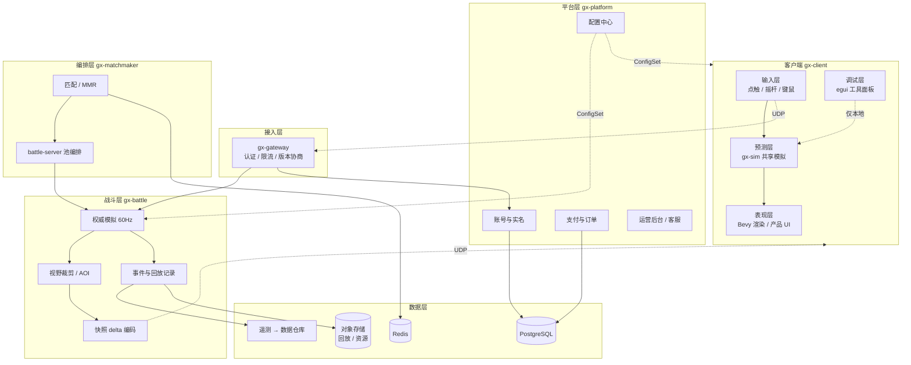

# GX-01 系统架构设计（含开发注意项）

| 项 | 内容 |
|---|---|
| 文档编号 | `GX-ARCH-2026-001` |
| 版本 / 日期 | v1.0 / 2026-11-06 |
| 上游 | `VG-FS-2026-001`（可行性研究 L2 路线）、`GX-TF-2026-001`（技术可行性） |
| 下游 | `GX-PRD-2026-001`、`GX-DEV-2026-001` |
| 现状基线 | `d:/rust/vainglory`：4 crate（game-core / client / server / matchmaking）、Bevy 0.20.1、renet2 0.12、bitcode 0.6、≈6,497 行 |
| 架构原则 | 服务端权威 · 演进式重构 · 数据驱动 · 视野即安全 · 表达层原创可自动校验 |

> 本文所有"现状"描述均来自对 `crates/**` 的只读盘点；所有"目标"描述为设计，尚未实现。开发注意项（§14）是本项目的**强制工程约束**，其中多条来自本仓库已实际发生的故障。

> **文档族（GX-01；游戏名《虚无荣耀》）**：本文档与下列文档共享同一套 ID 前缀（`TA`/`TF`/`ADR`/`ARC`/`FR`/`NFR`/`CR`/`UC`/`DEV`/`TC`/`GAP`/`DN`/`TR`），禁止各自另起编号；术语以本文 §2.1 为准。
>
> | 文档 | 编号 | 文件 |
> |---|---|---|
> | 技术可行性 | `GX-TF-2026-001` | `docs/01_TECHNICAL_FEASIBILITY.md` |
> | 系统架构 | `GX-ARCH-2026-001` | `docs/02_ARCHITECTURE.md` |
> | 需求规格 | `GX-PRD-2026-001` | `docs/03_REQUIREMENTS.md` |
> | 开发实施 | `GX-DEV-2026-001` | `docs/04_DEVELOPMENT.md` |
> | 对战详细规格 | `GX-CBT-2026-001` | `docs/05_COMBAT_SPEC.md` |
> | 表现层规范 | `GX-VIS-2026-001` | `docs/06_VISUAL_SPEC.md` |
> | 开发进度与状态 | `GX-PROG-2026-001` | `docs/07_PROGRESS.md` |
> | 上游可行性研究（合规留档，非本项目原创内容） | `VG-FS-2026-001` | `docs/VAINGLORY_FEASIBILITY_STUDY.md` |
> | 资产登记 | `GX-ASSET-REG-2026-001` | `ASSET_REGISTRY.md` |
> | 表达层禁用词 | — | `docs/TERM_DENYLIST.txt` |

### 目录

- §1 架构目标与质量属性
- §2 表达层原创：强制技术约束
- §3 总体架构
- §4 Crate 演进：从现状到目标
- §5 架构组件登记（ARC）
- §6 模拟与帧循环
- §7 数据模型
- §8 网络协议
- §9 安全与反作弊
- §10 可观测性与回放
- §11 部署与容量
- §12 质量属性 ↔ 架构机制对照
- §13 架构决策记录（ADR）
- §14 开发注意项（DN）—— 强制
- §15 追溯矩阵（架构 → 需求）
- 附录 A：ID 与术语索引
- 附录 B：现状 → 目标符号映射

---

## 1. 架构目标与质量属性

| 优先级 | 质量属性 | 可度量场景（对应 `GX-TF` 阈值） |
|---|---|---|
| 1 | **公平性 / 信息安全** | 任何客户端在任意时刻都无法从网络包中获得视野外敌方实体信息（TF-03） |
| 2 | **单位经济** | 单核并发房间 ≥8，单 tick P95 ≤4 ms（TF-01） |
| 3 | **一致性** | 相同输入序列在服务端与回放中逐 tick 一致（TF-08） |
| 4 | **响应性** | 150ms RTT / 3% 丢包下无可感拉扯，本地输入 ≤50ms 呈现（TF-04） |
| 5 | **可演进性** | 新增英雄/技能/装备不改核心代码；数值变更可热更（TF-07） |
| 6 | **合规可审计** | 表达层禁词 0 命中、资产来源 100% 登记、战斗服零 PII（TF-11/TF-06） |
| 7 | **可观测性** | 任意一局可完整回放；关键指标有 SLO 与告警 |

**架构不承诺**：一期不承诺 sub-30ms 触控响应、不承诺 60fps 全机型、不承诺 5v5、不承诺全球同服（见 `GX-TF-2026-001` §2.4）。

---

## 2. 表达层原创：强制技术约束

### 2.1 术语表（GX-01 内部命名，**产品与代码统一使用**）

| 规则层概念 | GX-01 术语 | 工程标识 |
|---|---|---|
| 3v3 地图 | 灰界裂谷 | `Ashrift` |
| 单条主道 / 野区 | 主道 / 林隙 | `Causeway` / `Thicket` |
| 可摧毁基地核心 | 源核 | `SourceCore` |
| 防御塔 | 哨塔 | `Sentry` |
| 小兵 | 战偶 | `Construct` |
| 中期可捕获首领 | 渊卫 | `AbyssWarden` |
| 经济占领点 | 辉矿（俗称兵矿） | `LodeShrine` |
| 强化兵线占领点 | 征募井 | `MusterWell` |
| 双方视野裁剪后的不可见区 | 战争迷雾 | `FogOfWar` / `ClientVisionSources` |
| 基地 / 回城点 | 归航台 | `RecallPad` |
| 野区商店 | 中途驿 | `Waystation` |
| 物理 / 法术出装 | 刃能 / 秘能 | `BLADE` / `ARCANE` |
| 辅助 / 输出 / 打野位 | 守誓 / 锋矢 / 游猎 | `GUARD` / `SPEAR` / `STALK` |
| 对局 | 遭遇战 | `Encounter` |

### 2.2 禁用词表（CI 强制）

`Vainglory`、`虚荣`、`最终荣耀`、`Super Evil`、`SEMC`、`E.V.I.L`、`Halcyon`、`Halcyon Fold`、`海希安`、`Sovereign's Rise`、`风暴高地`、`Vain Crystal`、`虚荣水晶`、`Kraken`、`克拉肯`、`Gold Mine`、`Minion Mine`、`金矿工`、`水晶哨兵`、`Sanctuary`、`WP`、`CP`、`ICE`、`Glory`、`Opals`、`Blitz`、`ARAL`、`Captain / Carry / Jungler`（作为产品文案时）、以及**全部原作英雄名与皮肤名**。

**适用范围**：源码标识符、注释、配置文件与配置键、资源文件名、日志字段、协议枚举、动画事件名、测试夹具数据、文档、市场材料、提交信息。

> **唯一例外**：`docs/` 下的合规留档文档（如上游 `VG-FS-2026-001` 与本文 §2.2 本身）为进行可区分性审查与法律举证而引用这些词，须集中在受控目录，并被 CI 扫描器显式排除。规则层映射表（"哪条规则借鉴自哪里"）属**法务留档**，不得进入游戏包体、不得进入产品文案。

### 2.3 门禁（ADR-10）
`gx-tools lint-assets` 在 CI 中执行：禁词扫描、资产来源登记校验、**外部资源路径扫描**（禁止运行时读取字体/图片/音频文件）、配置表引用完整性校验。任一失败即阻断合并。对应 `TF-11`、`CR-01`、`GX-CBT-2026-001` §16.3。

> **v1.2 表现层约束（本轮需求变更）**：表现层**全部由代码生成**，采用 Minecraft 式体素风格（轴对齐立方体 + 低分辨率像素纹理 + `Nearest` 采样），不依赖任何外部资源；UI 使用引擎内置字形的 ASCII 文案，禁止加载操作系统字体。完整约束 PRES-1~9 见 `GX-CBT-2026-001` §16。此约束取代 §2.1 中关于"原创 3D 模型 / 商用授权字体"的表述。

---

## 3. 总体架构

### 3.1 逻辑分层



### 3.2 进程与部署（一期单区域）

| 进程 | 数量 | 有状态 | 说明 |
|---|---|---|---|
| `gx-client` | 每玩家 | 是 | 桌面/移动端 |
| `gx-gateway` | ≥2 | 否 | UDP 接入、认证令牌校验、限流、版本协商 |
| `gx-battle` | 弹性 | **是**（房间内） | 一进程多房间；房间状态可整体迁移/排空 |
| `gx-matchmaker` | ≥2 | 否（队列在 Redis） | 匹配与 battle-server 分配 |
| `gx-platform` | ≥2 | 否 | HTTP：账号/实名/支付/配置/后台 |
| `gx-tools` | 按需 | 否 | 离线：回放、平衡模拟、资产校验 |

**关键边界**：战斗服不持有 PII、不直连数据库、不发起支付；它只认 `session_token → player_id` 的校验结果与对局配置快照。合规变更不会触及战斗热路径（ADR-11）。

### 3.3 核心数据流：一次输入到一帧画面

```
1. 客户端采集原始输入 → InputCmd{seq, tick, move, aim, ability_mask, ...}
2. 客户端立即用 gx-sim 做本地预测并渲染（不等待服务端）
3. UDP Unreliable → gx-gateway（令牌校验 + 速率限制）→ gx-battle
4. gx-battle 在下一个 FixedUpdate 消费已校验输入（迟到/重复/越界被丢弃）
5. 权威模拟推进一 tick → 产生事件与状态变更
6. visibility_system 按每个玩家的可见集过滤
7. delta 编码（相对 baseline_tick）+ 关键事件 Reliable 下发
8. 客户端收到快照：确认输入序号 → 回滚到该 tick → 重放未确认输入 → 平滑修正
9. 远端实体走插值缓冲；表现层渲染
```

---

## 4. Crate 演进：从现状到目标

### 4.1 现状（已核实）

| crate | 二进制 | 职责 | 问题 |
|---|---|---|---|
| `game-core` | lib | 共享组件/系统/协议/地图/定点数学 | 依赖 `bevy` 全量；逻辑与渲染类型耦合（`net.rs` 里直接 `impl From<Vec2f> for bevy::math::Vec2`） |
| `client` | `vainglory-client` | Bevy 客户端 | **反向依赖 `server` crate**；`interpolation` 为私有模块；`ClientPlugin` 未被 `main.rs` 使用 |
| `server` | `vainglory-server` | Headless 权威服 | 手动 `init_resource::<Assets<Mesh>>()` 仅为避免 spawn panic |
| `matchmaking` | `vainglory-mm` | axum HTTP 内存队列 | 与客户端**未集成**；`MatchStore` 占位；服务器地址写死 |

### 4.2 目标结构

| crate | 依赖 Bevy? | 职责 |
|---|---|---|
| `gx-sim` | 仅 `bevy_ecs` / `bevy_math`（无 `bevy_render`） | 组件、系统、规则、确定性工具；**服务端 / 客户端预测 / 回放 / 平衡模拟器共用** |
| `gx-net` | 否 | 协议类型、编解码、通道策略、版本协商、`Transport` trait |
| `gx-config` | 否 | `ConfigSet` 定义、加载、校验、版本化、热更协议 |
| `gx-client` | 是（完整） | 渲染、输入、预测、产品 UI、平台适配 |
| `gx-battle` | headless（`MinimalPlugins`） | 房间管理、权威循环、视野裁剪、快照、回放记录 |
| `gx-gateway` | 否 | 接入、认证、限流 |
| `gx-matchmaker` | 否 | 匹配、编排 |
| `gx-platform` | 否 | 账号 / 实名 / 支付 / 配置中心 / 运营后台 |
| `gx-tools` | 否 | 回放分析、平衡模拟、资产 lint、协议兼容测试 |
| `gx-proto-content` | 否 | 内容数据表（heroes / abilities / items / map / economy），**纯数据 + 校验** |

### 4.3 迁移顺序（禁止一次性重写）

> **v1.1 修订（经澄清 Q-02 授权）**：本表原与 `GX-DEV-2026-001` §2.2 / `GX-PRD-2026-001` §9 的阶段定义冲突，现统一以后两者为排期基准。

| 阶段 | 动作 | 不破坏的约束 / 闸门 |
|---|---|---|
| M0 | 合规与技术基线：对外二进制名与描述清理、第三方数据隔离到 `LEGAL/`、`rust-toolchain.toml`、CI 骨架、禁词与资产门禁、临时日志清理、法律意见归档 | **G0**：禁词 0 命中、资产登记 100%、可复现构建 |
| M1-a | 工程清理：死依赖、解除 `client → server`、`interpolation` 改 `pub mod` 并注册 `InterpolationPlugin`、`ClientPlugin` 处置、README 对齐 | 全测试通过；`-D warnings` 清零 |
| M1-b | 协议抽离：`net.rs` → `gx-net`、协议字段演进与双版本协商；`Transport` 抽象与接入认证 | `game-core` re-export 保持 API 兼容；E2E 不回归 |
| M1-c | 配置落地：`gx-config` + `gx-proto-content`，先迁技能/英雄/哨塔三类硬编码；校验器接入 CI | `TC-CFG-01` 通过 |
| M1-d | 网络加固：服务端视野裁剪、delta + 通道分级、预测/插值闭环、真实 RTT、状态恢复式重连 | **G1**：`TC-NET-01/02/03/04`、`TC-PRED-01` 通过 |
| M2 | 垂直切片（玩法闭环）与 `game-core → gx-sim` 逻辑共用；**TF-01 容量压测（自 G1 移入）**与 `cost_per_match` 实测 | **G2** |
| M3 | 上线就绪：账号实名支付、匹配编排、运营后台、反作弊、局外 UI、机型适配、CI/CD 完整化 | **G3** |
| M4 | 灰度与单位经济复核 | **G4** |

> **M0+M1 命名约定（经澄清 Q-11）**：现有 4 个 crate 名（`game-core` / `client` / `server` / `matchmaking`）**保持不变**，仅修改对外二进制名与 `description`；本阶段新增的组件 crate 采用 `gx-*` 命名。完整 crate 重命名推迟至 `game-core → gx-sim` 迁移阶段。
>
> **迁移红线**：任何阶段都必须保持 `cargo test --workspace` 通过，且保留一个无需外部服务的 `--features offline-dev` 单机调试启动路径（现状"1 人即开局"是有价值的调试能力，应保留为显式 feature，而不是删除）。

---

## 5. 架构组件登记（ARC）

| ID | 组件 | 关键接口 | 对应需求 |
|---|---|---|---|
| ARC-01 | `gx-client` 输入层 | `RawInput → InputCmd`；点触/摇杆双模可切换 | FR-40~44 |
| ARC-02 | `gx-client` 预测层 | `PredictionState{seq, tick, pending_inputs}`；回滚重放 | FR-51~53 |
| ARC-03 | `gx-client` 表现层 | 产品 UI（Bevy UI）、渲染、`CameraRenderGraph` | FR-80~86 |
| ARC-04 | `gx-net` 协议层 | `InputCmd` / `Snapshot` / `GameEvent` / `Transport` | FR-50~57 |
| ARC-05 | `gx-gateway` | `authenticate(token)`、限流、版本协商 | FR-70~73、CR-02 |
| ARC-06 | `gx-battle` 模拟循环 | `EncounterWorld::tick(inputs)` 60Hz | FR-01~16 |
| ARC-07 | 视野与 AOI | `VisibilitySet::for_player()`；空间哈希 | FR-60、CR-05 |
| ARC-08 | 目标状态机 | `CaptureObjective{owner, progress, reward}` | FR-04~06 |
| ARC-09 | 经济与装备 | `EconomyLedger`、`ItemCatalog`、`Inventory` | FR-30~35 |
| ARC-10 | `gx-config` | `ConfigSet{version, hash, tables}`、校验器、热更 | FR-90~92、NFR-07 |
| ARC-11 | `gx-platform` | 账号/实名/支付/配置中心/后台 | FR-70~78、CR-01~08 |
| ARC-12 | `gx-matchmaker` | 队列、MMR、`allocate_battle_server()` | FR-74~76 |
| ARC-13 | 回放与遥测 | `ReplayWriter`、结构化事件 → 数据仓库 | FR-93~96 |
| ARC-14 | `gx-tools` | 资产 lint、平衡模拟、协议兼容 | CR-01、NFR-11 |

---

## 6. 模拟与帧循环

### 6.1 服务端系统链（`FixedUpdate`, 60Hz，**必须 `.chain()` 保证顺序**）

现状 `server/src/simulation.rs` 已有 13 个系统 `.chain()`，目标按阶段扩展为：

| 阶段 | 系统 | 状态 |
|---|---|---|
| A 输入 | `tick_clock_system` → `apply_pending_inputs` → **`validate_input_system`** | 前两者已有；后者新增（序号/速率/范围校验） |
| B 意图与 AI | **`hero_intent_system`** → `ability_cast_system` → `attack_system` → **`construct_ai_system`** → **`neutral_ai_system`** → **`objective_capture_system`** | 中间两者已有；其余新增 |
| C 位移 | `movement_system` → `projectile_system` → **`collision_system`** | 前两者已有 |
| D 结算 | `damage_system` → `resolve_pending_hits` → **`status_effect_system`** → **`death_system`** → **`economy_system`** → `flush_damage_events` | 前两者与末者已有 |
| E 生成与胜负 | **`wave_spawn_system`** → **`camp_respawn_system`** → **`match_end_system`** | 全部新增；替换 `minion_spawn_system` / `jungle_spawn_system` 空壳 |
| F 同步 | **`visibility_system`** → **`snapshot_encode_system`** → **`event_flush_system`** → **`replay_record_system`** | 全部新增；`broadcast_snapshot` 重构 |
| G 维护 | `ability_cooldown_system` → `level_up_system` → `passive_gold_system` → `health_regen_system` → `energy_regen_system` | 已有，保留并改为读取 `ConfigSet` |

**顺序不变量**：
1. 输入校验必须早于任何状态变更；
2. 所有伤害必须先写入 `DamageSink`（现有 `Resource`）再由 `flush_damage_events` 统一发事件，禁止在系统内直接广播；
3. 视野裁剪必须在编码之前；
4. 生成/销毁实体后必须 `ApplyDeferred`，再进入下一阶段（见 DN-17）；
5. `ServerTick` 递增是全链第一个动作。

> **分阶段落地说明（v1.1，消除 §4.3 原排期与 ADR-05 的自相矛盾）**：F 阶段的 `visibility_system` 属于 **M1-d**，先于 M2 的任何玩法内容开发（ADR-05）；B/E 阶段的新增玩法系统属于 **M2**；G 阶段改为读取 `ConfigSet` 属于 **M1-c**。M1 结束时系统链仅包含"输入校验 / 视野 / 编码 / 回放记录"等加固项，玩法空壳保持 M2 再实现，避免超出本次交付终点。

### 6.2 客户端调度

| Schedule | 内容 | 约束 |
|---|---|---|
| `PreUpdate` | 网络收包、连接状态机、快照入队 | **必须早于 `FixedUpdate` 的预测** |
| `Update` | 原始输入采集、局外 UI 逻辑、相机跟随 | 输入一旦采集即写入本 tick 的 `InputCmd` |
| `FixedUpdate` | `gx-sim` 本地预测（与服务端共享代码）、`PredictionState` 记录 | 常量必须来自同一 `ConfigSet`，否则反复硬修正（DN-09） |
| `PostUpdate` | 快照应用 → 回滚重放 → 远端实体插值 → 渲染数据准备 | `InterpolationPlugin` 必须在此注册 |
| `EguiPrimaryContextPass` | **仅调试工具面板** | 产品 UI 不走 egui（ADR-09 / DN-01） |

### 6.3 状态机

- 客户端 `NetworkState`：`Connecting → Connected → InGame → Reconnecting → Disconnected`（现状已有，需把"重连换 client_id"改为会话恢复，DN-20）。
- 服务端 `ServerState`：`WaitingForPlayers → Loading → Running → Paused → Finished`（现状已有；**"≥1 人即 Running"必须改为可配置房间人数**，保留 `offline-dev` 例外，DN-06）。
- 对局内 `EncounterPhase`：`Deploy → Laning → ObjectiveActive → SuddenDeath → Settled`（新增，驱动 20 分钟节奏 L2-R5）。

---

## 7. 数据模型

### 7.1 ECS 组件（在现有 `components.rs` 上演进）

| 组件 | 现状 | 目标 |
|---|---|---|
| `Hero` | 17 个字段全 `f32`，`Default` 硬编码 1000 HP / 60 AD | 拆为 `HeroBase`（配置引用）+ `HeroState`（运行时）+ `Attributes`（由装备/等级派生，禁止直接改） |
| `NetId` | 已有 | 保持；增加 `EntityKind` 与生成代数（generation）防重用混淆 |
| `Team` | `Blue/Red/Neutral` | 保持，与表达层无关 |
| `PlayerInput` | `ability_mask` 位掩码 + `target_net_id` | 升级为结构化 `Intent{ability_id, target: EntityRef|Point, item_active}`，位掩码仅保留作协议压缩 |
| `Minion` / `Turret` / `JungleMonster` | 已有 | 重命名为 `Construct` / `Sentry` / `ThicketCreep`（术语表） |
| `DamageSink` | `Vec<(Entity, Entity, f32, DamageType)>` | 保持模式，增加 `tick` 与 `source_ability_id` 以支持回放 |
| 标记 | `LocalPlayer/ServerAuthority/Predicted/Interpolated` | 保持，**严禁混用**（DN-37） |
| 新增 | — | `StatusEffects`、`Visibility`、`Capturable`、`OwnerTeam`、`Inventory`、`EconomyLedger`、`RespawnTimer` |

### 7.2 NetId 生命周期（DN-29）
`生成 → 活跃 → 死亡倒计时 → 销毁`；销毁事件须带 `final_snapshot`，客户端据此清理插值历史与 UI 目标。`Entity` 与 `NetId` 的映射只在服务端权威维护，客户端只认 `NetId`。

### 7.3 配置表（`gx-proto-content`）

| 表 | 内容 | 校验规则 |
|---|---|---|
| `heroes` | 基础属性、成长、定位标签、技能组引用 | 所有引用可解析；无禁用词 |
| `abilities` | CD / 消耗 / 射程 / 目标类型 / 伤害 / 状态效果 | 伤害公式参数有限值；CD > 0 |
| `items` / `item_tree` | 价格、属性、合成边、主动效果 | 合成图为 DAG；无环；价格 > 0 |
| `constructs` / `sentries` | 波次、路点、血量、赏金 | 波次时间递增；赏金非负 |
| `objectives` | 占领阈值、刷新时间、奖励、推线 AI 参数 | 时间在 [0, match_duration] |
| `map` | 几何、草丛/遮蔽区、路点、出生点 | 坐标在边界内；路点连通 |
| `economy` | 补刀、赏金、被动收入、等级曲线 | 与 `match_duration` 自洽（目标 18±4 分钟） |
| `modes` | 房间人数、时长上限、胜利条件 | 与 `ServerState` 一致 |

`ConfigSet` 绑定 `version` + `content_hash`；**一局对局内配置版本不可变**（DN-25、TR-06）。客户端启动时上报 hash，不匹配则拒绝进入或强制资源更新。

---

## 8. 网络协议

### 8.1 消息演进（基于现有 `net.rs`）

| 消息 | 现状字段 | 目标增量 |
|---|---|---|
| `InputCmd` | `tick, move_dir, aim_dir, ability_mask, target_net_id, ping` | `seq, client_time_us, checksum, intent(结构化), config_hash, redundant_prev[]`；`ping` 改为真实 RTT 估计（DN-21） |
| `WorldSnapshot` | 全量 `EntitySnapshot` 数组 | 改为 `SnapshotHeader{tick, baseline_tick, config_hash, view_seq}` + `EntityDelta[]` + 周期 `BaselineSnapshot` |
| `EntitySnapshot` | health/energy/level/gold/cooldowns/pos | 加 `changed_mask`、`status_bits`、`owner_team`、`generation` |
| `GameEvent` | 21 变体 | 补 `ObjectiveCaptured`、`SourceCoreDestroyed`、`EncounterSettled`、`ReconnectState`、`ConfigMismatch` |
| `ClientMessage` | `PurchaseItem/UpgradeAbility/Chat/SurrenderVote` | 补 `ReconnectRequest`、`Ack{baseline_tick}`、`ClientMetrics` |
| `ServerMessage` | Welcome/HeroSpawn/MatchStart 等 | 补 `ConfigSetOffer`、`Reject{reason}`、`SessionResume` |

### 8.2 通道分级

| 数据 | 通道 | 频率 | 理由 |
|---|---|---|---|
| 输入 | Unreliable（带冗余重发） | 30~60 Hz | 迟到输入无价值；序号去重 |
| 状态 delta | Unreliable | 20 Hz | 新快照覆盖旧快照，重传无意义 |
| 基线快照 | Reliable | 每 2 s / 按需 | 恢复 delta 链 |
| 关键事件（死亡/占领/结算/购买） | ReliableOrdered | 事件驱动 | 必须不丢且有序，且**幂等**（DN-28） |
| 聊天 / 信号 | Reliable | 事件驱动 | 低频 |

> 现状把**全部**快照与事件走 `ReliableOrdered`（`server/src/networking.rs`），会造成队头阻塞，是 TF-02 的主要改造对象。

### 8.3 视野裁剪（安全核心，ADR-05）
`visibility_system` 对每个玩家计算可见集：己方全部 + 视野内敌方 + 中立目标（按规则）+ 已探明区域。**裁剪在序列化之前**，任何被裁剪实体不得出现在包体的任何字段（包括 `GameEvent` 的附带数据、小地图数据、统计信息）。抓包验证是 TF-03 的硬性验收。

### 8.4 版本协商
`PROTOCOL_VERSION`（现状 =1）与 `config_hash` 双版本号在握手时交换；不兼容时返回明确 `Reject`，不得静默降级或崩溃（TF-10）。

### 8.5 一期最小可见性规则集（经澄清 Q-04 授权自定义）

> 本规则集是对 `FR-60` / `CR-05` / `TC-NET-03` 的**规则细化**，用于消除"简化可见性"与"抓包零泄漏"之间的边界歧义。属一期范围；完整射线级 LoS 仍按 `GX-PRD-2026-001` §3.3 留到二期。

| 编号 | 规则 |
|---|---|
| VIS-1 | 服务端为**每个玩家**独立计算 `VisibilitySet`，裁剪在所有序列化之前执行（§6.1 顺序不变量 3） |
| VIS-2 | 己方阵营实体（英雄 / 战偶 / 哨塔 / 源核 / 归航台）**始终可见** |
| VIS-3 | 敌方实体可见条件：与任一己方「可见源」的距离 ≤ `vision_radius`（配置值），且不在遮蔽区内；否则一律从快照中剔除 |
| VIS-4 | 可见源 = 己方存活英雄 + 己方存活哨塔 + 己方战偶（是否在场由配置开关控制）；一期不做遮挡射线，仅做半径 + 遮蔽区判定 |
| VIS-5 | 遮蔽区（草丛 / 障碍）内的敌方实体，仅在距离 ≤ `brush_reveal_radius`（< `vision_radius`）时可见 |
| VIS-6 | 中立单位与占领目标：仅当其处于 VIS-3 判定的可见范围内时随快照下发；目标**归属状态**（owner / progress）属全局游戏状态，通过 `ObjectiveCaptured` 事件全局广播，但事件**不得携带任何敌方实体字段** |
| VIS-7 | `GameEvent` 中涉及实体 `NetId` 的变体（伤害 / 阵亡 / 施法 / 生成）必须按接收方 `VisibilitySet` 过滤后再下发；不可见实体的事件不得发出 |
| VIS-8 | 小地图与统计数据由快照派生，不设独立数据源；因此自动继承 VIS-3~7 的裁剪结果 |
| VIS-9 | 观战（`FR-16`，P2）与真实 LoS 遮挡为二期；一期无全局视野。`TC-NET-03` 的通过判据为"包体中不出现任何 VIS-3 判定为不可见的敌方实体字段（含事件附带数据、小地图、统计）"。**P-U10 补充**：客户端三档迷雾（可见 / 已探明 / 未探明）由服务端逐玩家下发的 `VisionUpdate` 可见源驱动，报文只含**己方**可见源坐标（VIS-2 本就全可见），不引入新信息，不改变上述抓包判据；墙体仍不遮挡视野 |

`vision_radius` / `brush_reveal_radius` 与遮蔽区几何来自 `gx-proto-content::map`，M1 阶段用占位值（外部依赖：需平衡验证，见 `GX-PRD-2026-001` §11）。

---

## 9. 安全与反作弊

| 层 | 措施 |
|---|---|
| 接入 | `gx-gateway` 令牌校验（替换现状 `ClientAuthentication::Unsecure` / `ServerAuthentication::Unsecure`）、DTLS/加密、每 IP 连接与包速率限制 |
| 输入 | 序号去重、时间戳窗口、移动速度上限（服务端用 `ConfigSet` 的 `move_speed` 复核）、技能 CD/能量/射程二次校验、目标合法性 |
| 信息 | 服务端视野裁剪（§8.3）；客户端永不接收敌方全量状态 |
| 状态 | 服务端权威；客户端不上传血量/金币/等级等权威字段（现状 `InputCmd` 无此问题，须保持） |
| 一致性 | `config_hash` 绑定；回放重算与上报结果比对 |
| 检测 | 离线行为检测（移动轨迹、施法频率、命中率异常）+ 举报流水线 |
| 审计 | 全量结构化日志；战斗服零 PII（ARC 边界） |

**明确不做**：客户端反调试/完整性校验作为一期强依赖（成本高、收益有限，且移动端环境复杂），列为二期可选项。

---

## 10. 可观测性与回放

| 类别 | 内容 |
|---|---|
| 日志 | `tracing` span 命名统一 `encounter_id/player_id/tick`；**清除现状 `[DMG]/[SNAP]/[CLT-INT]/[CLT-BAR]` 临时诊断日志**（DN-10） |
| 指标 | tick 耗时 P50/P95/P99、快照字节数、可见实体数、RTT、输入丢弃率、预测硬修正率、房间密度、崩溃率 |
| SLO | tick P95 ≤4 ms；崩溃率 ≤0.3%；对局完成率 ≥99.5% |
| 回放 | `ReplayWriter` 记录：输入流 + 基线快照 + 配置 hash + 关键事件；`gx-tools replay` 可逐 tick 复现（TF-08） |
| 数据 | 对局事件 → 遥测 → 数据仓库 → 平衡分析（禁止把遥测字典当配置源使用，见 §2.2） |

---

## 11. 部署与容量

- 一期单区域：`gx-gateway`/`gx-platform`/`gx-matchmaker` 无状态多副本；`gx-battle` 按房间水位弹性扩缩，缩容前**优雅排空**（等待在局结束，不强制断线）。
- 房间调度：`allocate_battle_server()` 返回实际地址，替换现状 `matchmaking/src/queue.rs` 写死的 `127.0.0.1:5000`（DN-08）。
- 客户端启动保留 `offline-dev` 模式（无需任何后端服务即可 1 人进房调试），但**该 feature 不得进入发布构建**。
- 容量与成本阈值见 `GX-TF-2026-001` §4.3，实测由 TF-01 回填。

---

## 12. 质量属性 ↔ 架构机制对照

| 质量属性 | 机制 | 验证 |
|---|---|---|
| 公平性 | ARC-07 视野裁剪 + 输入校验 | TF-03 抓包 |
| 单位经济 | ADR-07 一进程多房间 + delta 压缩 | TF-01 压测 |
| 一致性 | `gx-sim` 共用 + 回放 | TF-08 |
| 响应性 | 预测 / 插值 / 抖动缓冲 | TF-04 |
| 可演进 | `gx-config` 数据驱动 | TF-07 |
| 合规 | CI 禁词 + 资产登记 + PII 隔离 | TF-11 / TF-06 |
| 可观测 | 结构化日志 + 回放 + SLO | G3 |

---

## 13. 架构决策记录（ADR）

| ID | 决策 | 理由 | 代价 / 备选 |
|---|---|---|---|
| ADR-01 | 保留 Rust + Bevy 0.20 全栈，演进式重构 | 复用 6.5k 行骨架；服务端权威 + ECS + 无 GC 停顿适合 60Hz | Bevy 移动端生态风险 → TF-09 兜底：必要时仅客户端换商业引擎 |
| ADR-02 | 服务端权威 + 状态快照，**不用 lockstep / 全量定点** | MOBA 无需严格帧同步；规避 f32 跨平台一致性；回放靠服务端日志 | 需要更强的输入校验与带宽优化 |
| ADR-03 | `gx-sim` 与渲染解耦，仅依赖 `bevy_ecs`/`bevy_math` | 一套逻辑服务服务端/预测/回放/平衡模拟 | 需分阶段迁移，短期存在适配层 |
| ADR-04 | `Transport` trait 抽象，renet2_netcode 为默认 | 原生 UDP 在移动端/后台生命周期受限；Web 需 WebTransport | 多一层抽象与测试成本 |
| ADR-05 | **视野裁剪先于任何内容开发** | 后加会推翻协议、客户端假设与反作弊模型 | M1 工期前置 |
| ADR-06 | `ConfigSet` 版本化 + CI 校验 + 热更 | 现状全硬编码，平衡无法迭代 | 需构建配置校验器与兼容策略 |
| ADR-07 | 一进程多房间 | 单位经济优先（原作死于服务器成本） | 房间隔离与限流复杂度；TF-01 不达标则改房间进程化 |
| ADR-08 | 回放与反作弊共用输入/快照日志 | 一份设施两用 | 日志存储成本 |
| ADR-09 | 产品 UI 与 egui 调试面板分离 | 现状 egui 面板无法承担商业 UI（动效/多分辨率/触摸热区/本地化） | 需实现 Bevy UI 体系 |
| ADR-10 | 表达层原创为 CI 强制门禁 | 把法律约束变成可执行检查 | 需维护禁用词表与例外目录 |
| ADR-11 | 账号/合规/支付独立服务 | 合规变更不触及战斗热路径；战斗服零 PII | 多一次网络跳转 |
| ADR-12 | 匹配与 battle-server 编排解耦 | 修复现状地址写死、无法扩容 | 需服务发现与健康检查 |

---

## 14. 开发注意项（DN）—— **强制**

> 以下为本项目开发必须遵守的工程约束。标注「现状」的条目在仓库中**已经存在或已经发生过故障**，不是假想风险。

### 14.1 Bevy / egui 集成

| ID | 注意项 | 现状证据 | 要求 |
|---|---|---|---|
| DN-01 | **egui 主上下文必须唯一且挂在带渲染图的相机上** | 本仓库实际故障：`auto_create_primary_context=true` 时，某依赖插件在游戏相机之前生成了裸 `Camera`（无 `CameraRenderGraph`），自动创建把 `PrimaryEguiContext` 挂到它上面 → UI 全不渲染；随后手动在游戏相机上又挂了一个 `PrimaryEguiContext` → 两个上下文共享 `EguiPrimaryContextPass` 调度 → panic `Each Egui context must have a unique schedule` | 固定组合：`UiPlugin::build` 中 `insert_resource(EguiGlobalSettings{auto_create_primary_context:false, ..default()})` + 仅在 `spawn_game_scene` 的相机（含 `CameraRenderGraph::new(Core3d)` 与 `Camera3d`）上挂 `PrimaryEguiContext`。**不得再新增第二个上下文**；若确需第二上下文，必须用 `EguiSchedule::new(自定义 ScheduleLabel)` 且标签唯一 |
| DN-02 | UI 系统不要 `.chain()` | `ui.rs` 已去掉 `.chain()` | 模拟系统链必须 `.chain()`（严格顺序），UI 系统之间禁止 chain（单个失败不应连累全部窗口） |
| DN-03 | `ctx_mut()` 必须容错 | 已改为 `let Ok(ctx) = ... else { return; }` | 禁止 `.expect("no egui context")`；上下文未就绪时静默跳过该帧 |
| DN-04 | 调试 UI 与产品 UI 分离 | `ui.rs` 的 HUD/小地图/技能栏/商店/调试面板均为 egui | egui 仅保留为**开发工具**（`#[cfg(feature="dev-tools")]`）；产品 UI 用 Bevy UI，发布构建不编译 egui 面板（ADR-09） |
| DN-05 | 主摄像机必须带显式渲染图 | 现状 `Camera3d + Camera + CameraRenderGraph::new(Core3d)` | 任何新增相机都必须明确 `CameraRenderGraph` 或 `Camera2d/Camera3d`；否则 bevy_render 告警且 UI 可能无渲染目标 |
| DN-06 | **禁止运行时加载操作系统字体** | 原 `setup_cjk_font` 从 `C:/Windows/Fonts/` 尝试 5 个文件，仅 Windows 可用且许可不明 | **v1.2 修订**：删除该系统，UI 文案改用引擎内置字形的 ASCII 字符集；表现层全部代码生成（`GX-CBT-2026-001` §16 PRES-3）。`TC-CBT-12` 扫描断言源码中无字体路径字面量 |

### 14.2 网络与同步

| ID | 注意项 | 现状证据 | 要求 |
|---|---|---|---|
| DN-07 | 禁止全量 `ReliableOrdered` 广播状态 | `server/src/networking.rs` 快照与事件全走可靠有序 | 按 §8.2 分级；状态 delta 走 Unreliable + 周期基线 |
| DN-08 | 地址/端口不得硬编码 | client `127.0.0.1:5000`、server `0.0.0.0:5000` 且令牌地址写死回环、mm `0.0.0.0:8080`、mm 返回地址写死 | 全部走配置/环境变量；对外令牌地址必须由网关下发真实可达地址 |
| DN-09 | 客户端与服务端必须共享同一份模拟代码与常量 | `HERO_BASE_MOVE_SPEED = 8.0` 与 `Hero::default().move_speed = 3.5` 已存在不一致风险 | 移速/攻速/CD 等一律从 `ConfigSet` 读；禁止两边各写常量，否则预测回滚反复硬修正 |
| DN-10 | 临时诊断日志必须清理 | `[DMG]/[SNAP]/[CLT-INT]/[CLT-BAR]` 仍在源码 | 改为 `tracing` 结构化字段 + 按级别开关；发布构建不含临时日志 |
| DN-11 | `InterpolationPlugin` 必须注册 | `client/src/interpolation.rs` 已实现，但 `main.rs` 未注册（死代码） | M1-c 注册并加一条集成测试断言"远端实体位置被插值" |
| DN-12 | 禁止把视野外实体写入任何下发数据 | 现状全量 `WorldSnapshot` | 裁剪作用于快照、事件附带数据、小地图、统计；抓包回归用例 `TC-NET-03` |
| DN-13 | `InputCmd.ping` 必须真实 | `prediction.rs` 写死 0 | 由网关/服务端回显计算 RTT，用于抖动缓冲与指标 |
| DN-14 | 事件必须幂等 | Reliable 通道可能重传 | `GameEvent` 带 `event_id`；客户端按 id 去重，避免死亡/购买重复结算 |

### 14.3 ECS 与调度

| ID | 注意项 | 现状证据 | 要求 |
|---|---|---|---|
| DN-15 | `FixedUpdate` 与 `Update` 的职责边界 | 输入在 `Update`、预测在 `FixedUpdate` | 输入采集结果必须写入同一 tick 的 `InputCmd`；禁止在 `Update` 直接改权威状态 |
| DN-16 | `Query::single()` 的多实体语义 | `ui.rs` 多处 `hero_query.single()` | 明确使用返回 `Result` 的 `get_single()` 或 `single()` 的 Result 语义；本地英雄唯一性由生成逻辑保证，禁止在可能 0/多实体的查询上直接解引用 |
| DN-17 | `ApplyDeferred` 时机 | `game-core/src/systems.rs` 生成系统为空壳 | 生成/销毁实体后插入 `ApplyDeferred`，否则同帧后续 Query 看不到新实体，出现"生成了但没动/没被打" |
| DN-18 | Query 冲突检测 | 多个系统对同一组件 `&mut` | 新增系统必须跑 `cargo test` 的调度构建用例（现有 `rendering_plugin_schedule_builds_without_query_conflict` 可复用模式） |
| DN-19 | headless 服务端的资源初始化 | `server/src/main.rs` 手动 `init_resource::<Assets<Mesh>>()`、显式 `StatesPlugin`（`MinimalPlugins` 不含） | 迁移 `gx-sim` 后应彻底移除 `Assets<Mesh>` / `StandardMaterial` 依赖；若仍需，写清注释与单测 |
| DN-20 | 断线重连不得换身份 | `try_reconnect` 用新随机 `client_id` 重连、服务端生成全新英雄 | 用会话令牌恢复 `player_id/net_id`，下发 `SessionResume` + 完整基线快照；重连窗口与掉线托管规则由配置定义 |
| DN-21 | 1 人即开局只能是调试特性 | `server/src/lib.rs` 注释自述"便于单人/双人测试训练假人"；README 却写"满 6 人" | 房间人数从 `ConfigSet` 读，默认 6；`--features offline-dev` 才允许 1 人开局，且发布构建禁用 |
| DN-22 | 标记组件不可混用 | `LocalPlayer/ServerAuthority/Predicted/Interpolated` | 同一实体不得同时是 `Predicted` 与 `Interpolated`；加断言或调试检查 |

### 14.4 数据与配置

| ID | 注意项 | 现状证据 | 要求 |
|---|---|---|---|
| DN-23 | 禁止硬编码数值 | `Hero::default()`、`abilities.rs` 4 技能、塔/Crystal 血量 `5000.0`、`map.rs` 全坐标、`max_clients:64`、`RECONNECT_INTERVAL=3.0` | 全部迁至 `gx-proto-content`；代码中不得出现平衡数值字面量（CI 可加简单规则检查） |
| DN-24 | 定点数不要误用 | `fixed`/`DeterministicRng` 存在但主模拟/快照/预测仍用 f32 | 按 ADR-02：不追求全量定点；仅回放/校验关键字段可定点化。**禁止在文档中宣称"已具备确定性"** |
| DN-25 | 配置热更的局内一致性 | 现状无配置体系 | `ConfigSet` 版本绑定对局，一局内不切换；新旧版本共存时按 `config_hash` 分房 |
| DN-26 | 未知技能 id 不得静默兜底 | `get_ability_def` 对未注册 id 返回"未知技能"占位定义 | 配置校验阶段即拒绝未知 id；运行时遇到应记错误并拒绝施法，不能产生"放了个空气技能" |
| DN-27 | 模拟不得用系统时钟 | `TickClock` 已有固定步长累加器 | 一律用 `ServerTick` / `TickClock`；禁止 `SystemTime::now()` 进入模拟逻辑 |
| DN-28 | 每 tick 分配要受控 | 快照/Vec 每帧重建 | 复用缓冲、对象池；压测中监控分配量（TF-01） |

### 14.5 合规与资产

| ID | 注意项 | 现状证据 | 要求 |
|---|---|---|---|
| DN-29 | 第三方数据不得进入发布包 | `dictionaries/*.json`、`assets/resources/**` 遥测样本 ≈3.7 MB，标注 "Copyright 2017 Super Evil Megacorp"，但代码未读取 | 隔离到 `LEGAL/` 或移出仓库；发布流水线显式排除；**禁止据此生成商品化数值表** |
| DN-30 | 命名与描述清理 | `Cargo.toml` 的 `"Vainglory Rust reimplementation"`、窗口标题 `"Vainglory - Client"`、二进制名 `vainglory-*`、README 标题 | 全部改为 GX-01 代号；git 历史中的对外描述一并评估 |
| DN-31 | 独立创作证据链 | 仓库无资产来源登记 | 每个美术/音频/配置资产登记作者、来源、日期；设计稿与提交历史可追溯；CI 校验（TF-11） |
| DN-32 | 发布包零第三方表现资产 | 原 `setup_cjk_font` 直接读 Windows 系统字体 | **v1.2 修订**：几何/纹理/材质/图标/字形全部由代码生成，无字体与音频资产可登记；第三方内容仅留在 `LEGAL/` 且不得进入发布包（`GX-CBT-2026-001` §16.3） |
| DN-33 | 规则层映射表不外泄 | — | 映射表仅存法务留档目录，被 CI 扫描器排除；不进入包体、日志、市场材料 |

### 14.6 工程与测试

| ID | 注意项 | 现状证据 | 要求 |
|---|---|---|---|
| DN-34 | 解除 `client → server` 反向依赖 | `client/Cargo.toml` 有 `server = { path = "../server" }` | 共享内容下沉到 `gx-net`/`gx-sim`；客户端不得依赖服务端 crate |
| DN-35 | 死代码与未使用依赖 | `ClientPlugin` 未被 `main.rs` 使用；`interpolation` 为私有模块；`bevy_renet2`/`glam`/`redis` 零引用 | 要么注册并测试，要么删除；CI 开 `-D warnings` 前先清零 |
| DN-36 | 提交 `Cargo.lock` | **v1.1 勘误**：盘点时误记为"仓库无锁文件"；实测 `git ls-files` 确认 `Cargo.lock` 已被跟踪 | 保持锁文件纳入版本控制；CI 用 `--locked` 构建，禁止 `cargo update` |
| DN-37 | 工具链锁定 | edition 2024 需 Rust ≥1.85 | 用 `rust-toolchain.toml` 固定版本；CI 与本地一致 |
| DN-38 | 文档与代码一致性 | README 第一节称技能已实现、第三节仍列未完成；称"满 6 人"但代码 1 人即开局；记录一个未解决掉血 Bug | 每次合并同步更新 README；已知 Bug 要么修复要么登记为 issue 并标注影响 |
| DN-39 | 测试要覆盖调度与协议 | 现有约 15 个测试，含握手/移动/伤害 E2E | 新增：视野裁剪抓包、delta 收敛、配置校验、回放一致性、协议兼容（对应 `TC-*`） |
| DN-40 | 离线可开发 | 现状单机可跑是有价值的 | 保留 `offline-dev` 一键启动（客户端+headless 服同进程或本地两进程），但发布构建禁用该 feature |

---

## 15. 追溯矩阵（架构 → 需求）

| 架构组件 / 决策 | 覆盖需求 |
|---|---|
| ARC-06 模拟循环 + §6.1 系统链 | FR-01~FR-16 |
| ARC-09 经济与装备 | FR-30~FR-35 |
| ARC-01 输入层 | FR-40~FR-44 |
| ARC-04 / ARC-02 协议与预测 | FR-50~FR-57 |
| ARC-07 视野裁剪 | FR-60~FR-63、CR-05 |
| ARC-11 / ARC-12 / ARC-05 | FR-70~FR-78、CR-01~CR-08 |
| ARC-03 表现层 | FR-80~FR-86 |
| ARC-10 / ARC-13 / ARC-14 | FR-90~FR-96、NFR-07、NFR-11 |
| ADR-10 + §2 禁词门禁 | CR-01、NFR-12 |
| §14 全部 DN | `GX-DEV-2026-001` 的 DoD 检查表 |

---

## 附录 A：ID 与术语索引

- ID 前缀定义见 `GX-TF-2026-001` §0。
- 术语表见本文 §2.1；禁用词表见 §2.2。
- 需求编号定义见 `GX-PRD-2026-001` §4；开发任务编号见 `GX-DEV-2026-001` §4。

## 附录 B：现状 → 目标符号映射（供迁移使用）

| 现状符号 | 目标 |
|---|---|
| `game-core::components::Hero` | `gx_sim::HeroBase` + `HeroState` + `Attributes` |
| `game-core::net::{InputCmd, WorldSnapshot, GameEvent}` | `gx_net::{InputCmd, Snapshot, GameEvent}`（字段演进见 §8.1） |
| `game-core::systems::minion_spawn_system`（空壳） | `gx_sim::wave_spawn_system` |
| `game-core::map::*` 常量 | `gx_proto_content::map` 配置表 |
| `server::networking::broadcast_snapshot` | `gx_battle::snapshot_encode_system` + `event_flush_system` |
| `client::prediction::PredictionState` | 保留，增加 `seq` 与 `config_hash` |
| `client::interpolation::InterpolationPlugin` | 保留，**注册到 App** |
| `matchmaking::queue::server_addr`（写死） | `gx_matchmaker::allocate_battle_server()` |
| `ClientAuthentication::Unsecure` | `gx_gateway` 令牌校验 |
| `ServerState`（1 人即 Running） | 人数来自 `ConfigSet`，`offline-dev` 例外 |
| `ClientPlugin`（`client/src/lib.rs`） | 删除或合并进 `gx-client` 启动装配 |

---

*本文为设计文档；所有"目标"项的实现顺序、任务卡与验收方法见 `GX-DEV-2026-001`。*
